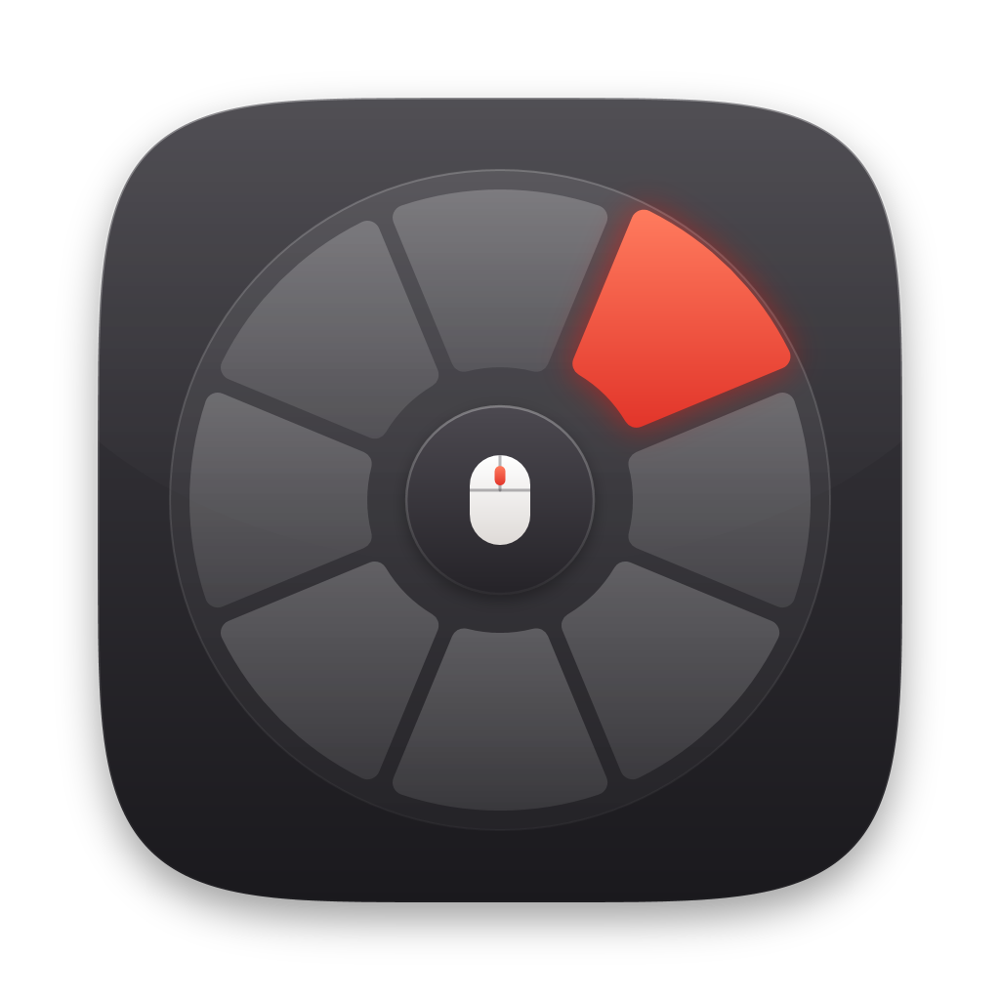

<p align="center">
  
</p>

<h1 align="center">Orbi</h1>

<p align="center">Ferramentas rápidas para Windows que orbitam o seu cursor.</p>

---

Segure uma tecla (por padrão o **Alt esquerdo**) e um menu radial aparece em volta do mouse com clipboard, captura de tela, timer, snippets, microfone, monitor, baixador de vídeos e servidor pessoal. Você abre, usa e volta ao trabalho sem trocar de janela.

O Orbi roda em segundo plano, com um ícone na bandeja do Windows, e não tem janela principal.

## Requisitos

- Windows 10 ou 11
- [.NET 10 SDK](https://dotnet.microsoft.com/download/dotnet/10.0), para compilar e instalar (já inclui o runtime para rodar)
- Opcionais, conforme o módulo:
  - **yt-dlp**, para o baixador de vídeos. O próprio Orbi instala se faltar.
  - **ffmpeg**, para juntar vídeo e áudio em alta resolução e converter para MP3.
  - **Tailscale** e uma **chave SSH sem senha**, para o módulo Servidor.
  - Um monitor com **DDC/CI** ativado no menu dele, para o módulo Monitor.

## Instalação

```powershell
git clone https://github.com/naoentendotu/orbi-app.git
cd orbi-app
powershell -ExecutionPolicy Bypass -File .\instalar.ps1
```

O script:
1. gera um único `Orbi.exe` (~7 MB, usa o .NET já instalado);
2. instala em `%LOCALAPPDATA%\Programs\Orbi`, sem precisar de administrador;
3. cria o atalho **Orbi** no Menu Iniciar;
4. abre o app.

Depois disso, abra pelo Menu Iniciar ou ative **Ajustes → Iniciar com o Windows**. Para atualizar, rode `git pull` e o script de novo: ele fecha o Orbi aberto, substitui o executável e abre de novo.

**Desinstalar:** feche o Orbi (bandeja → Sair), desative "Iniciar com o Windows" se estiver ligado, e apague `%LOCALAPPDATA%\Programs\Orbi` e o atalho do Menu Iniciar. Seus dados ficam em `%APPDATA%\Orbi`; apague essa pasta também se quiser remover tudo.

## Como usar

| Ação | O que acontece |
| --- | --- |
| **Segurar a tecla** (Alt esquerdo, ~250 ms, sozinha) | O menu radial abre em volta do mouse |
| **Passar o mouse numa fatia** | Aparece a prévia ao lado, com as ações mais comuns |
| **Soltar a tecla** | O menu fecha |
| **Clicar numa fatia** | Abre o painel completo e o menu fica fixado |
| **←** no painel | Volta para a prévia |
| **Alfinete** | Fixa o menu aberto ou, se já estiver fixado, fecha |
| **Esc** ou clicar fora | Fecha o menu fixado |
| **Clique no ícone da bandeja** | Abre o menu já fixado |

- Atalhos como Alt+Tab e Alt+F4 continuam normais: o menu só abre quando a tecla é segurada **sozinha**.
- A tecla e o tempo podem ser trocados, ou você pode usar uma **combinação de teclas** (veja [Ajustes](#ajustes)).
- Clicar num campo de texto dentro de uma prévia fixa o menu, para você poder digitar.
- Toda ação mostra uma confirmação no painel. O que termina com o menu fechado (download, captura, alarme) aparece como notificação do Windows.

## Módulos

### Clipboard
- Registra **textos, links e imagens**, com um ícone para cada tipo.
- Clique num item para **copiar de novo**; passe o mouse para ver o conteúdo completo.
- **Busca**, **favoritos** (★), **excluir** um item ou **limpar** tudo (os favoritos ficam).
- **Guardar por** 1 hora, 1 dia, 7 dias, 30 dias ou sempre. Itens vencidos são apagados também do disco; favoritos nunca expiram.
- Guarda até 200 itens; repetidos sobem para o topo em vez de duplicar.
- Conteúdo que **gerenciadores de senha** marcam para ficar fora do histórico é ignorado.

### Captura
- **Tela** (o monitor do mouse), **Janela** (a que estava em foco) ou **Região** (a tela congela, você arrasta; Esc cancela).
- Copia para a área de transferência e/ou salva em `Imagens\Orbi`, em **PNG** ou **JPG**, pasta configurável.
- Prévia da última captura com **Editar** (editor padrão do Windows) e **Pasta**.

### Timer
- **Temporizador**: 1, 5, 10 e 25 min ou tempo livre (`25`, `5:30`, `1:00:00`); notificação e som ao terminar.
- **Cronômetro** com voltas.
- **Alarmes**: horário, dias da semana (sem dias = toca uma vez), nome, **som personalizado**, ligar/desligar.

### Snippets
- Textos que você usa sempre, em categorias (Textos e mensagens, E-mails e assinaturas, Desenvolvimento, Comandos, Informações pessoais, Personalizados) ou em **categorias novas**.
- **Busca**, **favoritos**, **copiar com um clique**, editar e excluir.

### Microfone
- Botão grande para **silenciar/ativar**, com o estado visível também no ícone da fatia.
- Mostra o **dispositivo de entrada** e permite **trocar o padrão**.

### Monitor (DDC/CI)
- **Brilho** e **contraste**, **temperatura de cor** e **modo de imagem**.
- **Perfis** Trabalho, Jogos, Filmes e Personalizado; qualquer um pode **guardar o estado atual**.
- **Low Blue Light**: cada fabricante usa um código próprio. Use **Escanear** (só lê), mude o Low Blue Light nos botões do monitor e escaneie de novo: o código que mudou aparece e você salva.
- Comandos perigosos (reset de fábrica, troca de entrada, desligar) são **bloqueados**.

### Vídeos
- Baixa do YouTube, X/Twitter e [outros sites do yt-dlp](https://github.com/yt-dlp/yt-dlp/blob/master/supportedsites.md). Um link copiado já aparece preenchido.
- **Resolução** ou **só áudio** (MP3 com ffmpeg), formato **MP4, MKV ou WEBM**.
- **Fila** com progresso, velocidade e tempo restante; pausar, continuar, cancelar e tentar de novo; **histórico**.
- Se faltar o yt-dlp, o botão **Instalar yt-dlp** baixa o executável oficial do GitHub.

### Servidor (Tailscale)
- **Status** da tailnet e do servidor, botão **Conectar**, **dashboard** e **atalhos** (`{host}` na URL vira o endereço do servidor).
- **Enviar arquivos** arrastando para o painel (fixe o menu antes) ou escolhendo, com progresso e velocidade, para uma **pasta de destino** escolhida.
- Usa SFTP com a sua chave SSH. A identidade do servidor é guardada na primeira conexão; se mudar, o envio é bloqueado.
- **Primeiro uso:** clique na fatia, escolha o servidor e preencha usuário, porta e chave (padrão `~/.ssh/id_ed25519`).

## Ajustes

Ficam na fatia **Ajustes** (ou bandeja → Ajustes).

- **Como abrir o menu**
  - **Segurar uma tecla**: clique em *Gravar…* e aperte a tecla. Alt, Ctrl, Shift e Win continuam funcionando normalmente; Caps Lock, F1–F24, Scroll Lock, Pause, Insert e Menu passam a ser só do Orbi. Ajuste o **tempo segurando** (150–1500 ms) e o que acontece **ao soltar**.
  - **Combinação de teclas**: grave um atalho como `Ctrl + Shift + Espaço`. Abre o menu fixado; apertar de novo fecha.
- **Módulos no menu**: ativar, desativar e reordenar.
- **Tema** automático, claro ou escuro.
- **Cor de destaque** e **cor do círculo**: cores prontas no estilo macOS ou qualquer cor em hex. O texto se ajusta para continuar legível.
- **Tamanho**, **opacidade** e **posição** (cursor ou centro da tela).
- **Iniciar com o Windows**.

## Privacidade

- Nada é enviado para lugar nenhum sozinho. Tudo fica no seu PC, em `%APPDATA%\Orbi`.
- Conexões só acontecem quando você pede: instalar o yt-dlp, baixar um vídeo ou enviar arquivos para o seu servidor.
- O histórico do clipboard fica em texto puro no seu computador. Use **Guardar por** ou **Limpar** se copiar algo sensível.

| Arquivo em `%APPDATA%\Orbi` | Conteúdo |
| --- | --- |
| `settings.json` | Ajustes, cores e atalho |
| `clipboard.json` + `clipboard-images\` | Histórico do clipboard |
| `snippets.json` | Snippets e categorias |
| `alarms.json` | Alarmes |
| `screenshot.json` | Pasta, formato e última captura |
| `monitor.json` | Perfis, Low Blue Light e último escaneamento |
| `downloads.json` | Pasta, formato e histórico de downloads |
| `server.json` | Servidor, SSH, atalhos, destinos e identidades confiáveis |
| `bin\yt-dlp.exe` | yt-dlp instalado pelo app |
| `error.log` | Erros inesperados (o app continua rodando) |

## Limitações conhecidas

- Com monitores de **escalas (DPI) diferentes**, o menu e a seleção de região podem sair um pouco deslocados.
- Ao gravar uma tecla para segurar, o **AltGr** é lido como "Ctrl esquerdo".
- Os **botões laterais do mouse** não podem ser usados como gatilho.
- O envio ao servidor não funciona com **chave SSH protegida por senha**.

## Desenvolvimento

```powershell
dotnet run --project src/Orbi     # roda sem instalar
dotnet test                       # testes da lógica (xUnit)
```

`Orbi.exe --open` abre o menu já fixado ao iniciar.

```
src/Orbi/
  App.xaml(.cs)   início, bandeja, tema e cores, atalho de abertura, registro dos módulos
  Core/           tecla segurada, hook de teclado, atalho global, cores, armazenamento, IModule
  Shell/          menu radial (RadialWindow) e helpers de UI
  Themes/         cores claro/escuro e estilos
  Modules/        um diretório por módulo
tests/Orbi.Tests/ testes da lógica
assets/           logo e ícone
instalar.ps1      gera e instala o Orbi.exe
```

**Criar um módulo:** implemente `Core/IModule` (`Id`, `Title`, `Glyph` da fonte Segoe Fluent Icons, `Status`, `Preview`, `Expanded`), registre no array `modules` de `App.xaml.cs` e ative em **Ajustes → Módulos no menu**.
